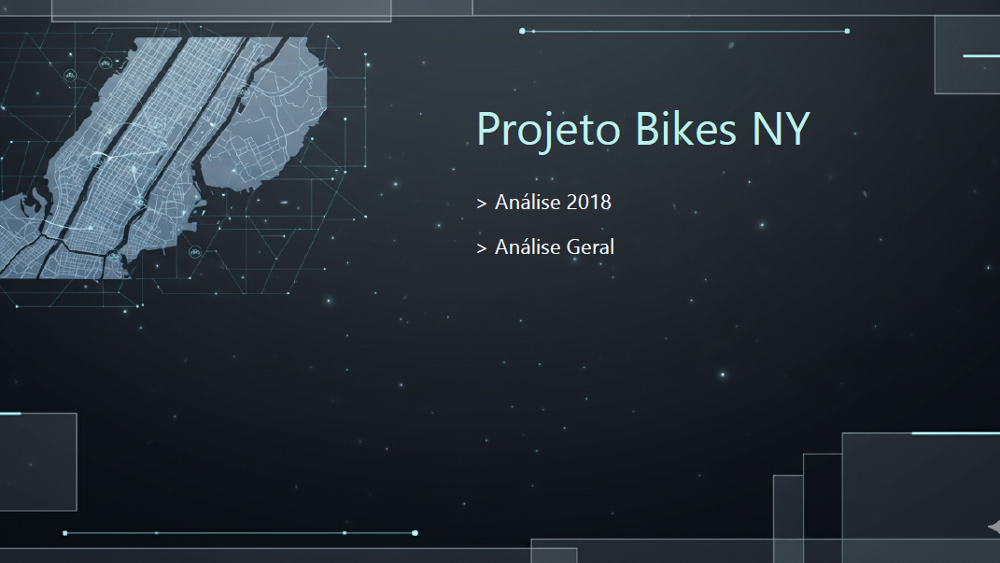
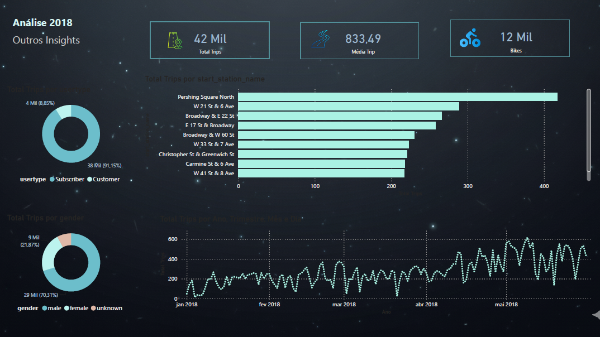
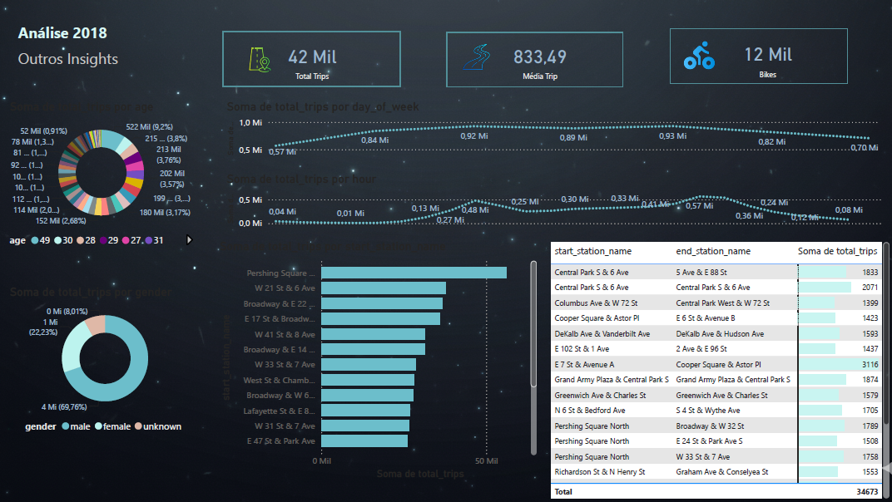
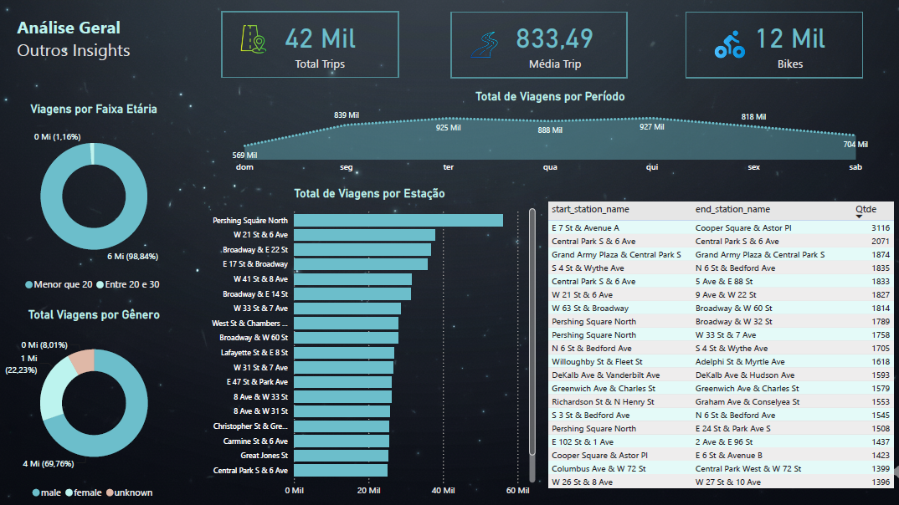

# 🚲 Projeto Bikes NY — Análise de Dados 2018

## 📌 Sobre o projeto

Este projeto consiste na análise de dados de um serviço de compartilhamento de bicicletas em Nova York, referentes ao ano de 2018.

O dashboard foi desenvolvido no Power BI como parte dos meus estudos em Análise de Dados, com o objetivo de explorar padrões de utilização, perfil dos usuários e movimentação entre estações.

Além da análise dos indicadores, o projeto teve como foco a clareza na apresentação das informações e a experiência do usuário, adaptando títulos, legendas e termos técnicos para facilitar a interpretação dos dados.

## 🎯 Objetivos

- Analisar o volume total de viagens e a duração média dos trajetos.
- Explorar o perfil dos usuários do serviço.
- Identificar as estações com maior movimentação.
- Investigar os fluxos entre estações de origem e destino.
- Analisar os padrões de utilização por dia da semana e horário.
- Desenvolver visualizações claras e intuitivas no Power BI.

## 🛠️ Ferramentas utilizadas

- **Power BI:** criação do dashboard e visualização dos dados.
- **Google BigQuery:** consulta e obtenção dos dados.
- **CSV:** armazenamento das tabelas utilizadas na análise.

## 📊 Principais análises

### 1. Análise de 2018
Indicadores gerais, duração média das viagens, utilização das bicicletas e movimentação por estação.

### 2. Perfil dos usuários
Distribuição das viagens por tipo de usuário, gênero e idade, conforme os dados disponíveis.

### 3. Fluxo entre estações
Exploração das conexões entre estações de origem e destino.

### 4. Análise geral
Visualização consolidada dos indicadores, das estações mais movimentadas e dos padrões de utilização.

## 💡 Aprendizados

Durante o desenvolvimento, trabalhei com análise de dados, visualização de indicadores e organização de informações em dashboards.

Um dos principais aprendizados foi a importância da experiência do usuário: apresentar dados não significa apenas exibir números, mas também tornar as informações compreensíveis e úteis para quem as consulta.

## 📁 Estrutura do repositório

- `README.md`: documentação e apresentação do projeto.
- `imagens/`: capturas de tela do dashboard.
- `dados/`: arquivos CSV utilizados na análise.

## 👨‍💻 Autor

Projeto desenvolvido como parte dos meus estudos em Análise de Dados, com foco em Power BI e visualização de informações.

## 🖼️ Visualização do Dashboard

O projeto foi desenvolvido no Power BI e está organizado em diferentes páginas para facilitar a exploração dos indicadores e a interpretação dos dados.

### Capa do projeto

### Análise de 2018

Esta página apresenta os indicadores gerais, como total de viagens, duração média e quantidade de bicicletas, além de gráficos sobre usuários, estações e evolução das viagens.

### Perfil dos usuários e movimentação

Esta visão explora informações demográficas e padrões de movimentação entre estações, incluindo viagens por idade, gênero e períodos de utilização.

### Análise geral

A página consolidada apresenta os indicadores gerais, a distribuição das viagens por período, as estações mais movimentadas e as conexões entre pontos de origem e destino.
